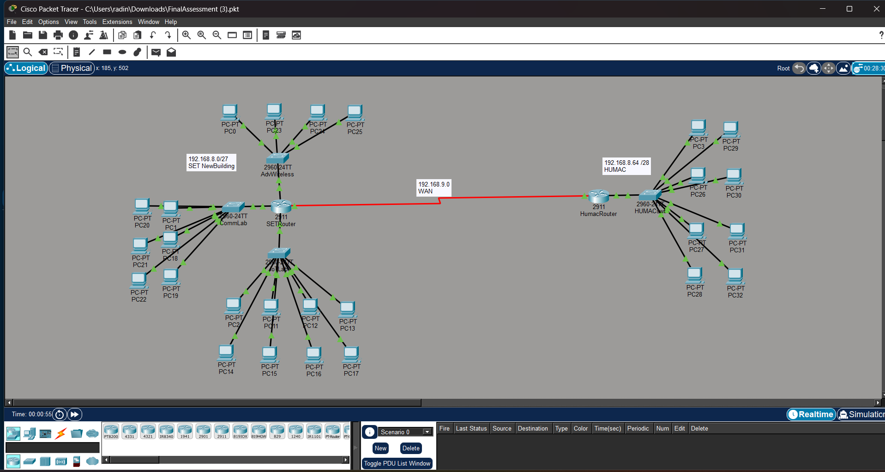
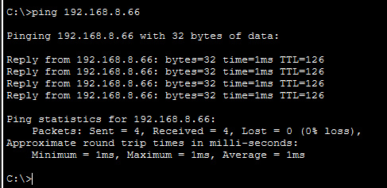

# NET1014 Networking Principles

A Cisco Packet Tracer network-design and implementation project completed for the NET1014 Networking Principles group assignment at Sunway University.

## Project overview

This project covers:
- The seven-layer OSI model, including encapsulation and data flow.
- Physical and logical network design for the SET New Building and HUMAC labs.
- IPv4 subnetting and address allocation using VLSM.
- Router and switch interface addressing and routing between sites.
- Connectivity checks using ping and traceroute.
- Equipment selection and estimated network-equipment costs.

## Project files

```text
networking-principles/
├── README.md
├── Packet-Tracer/
│   └── FinalAssessment.pkt
└── Documentation/
    └── Networking-Assignment.pdf
```

- **`Packet-Tracer/FinalAssessment.pkt`** — Cisco Packet Tracer network simulation.
- **`Documentation/Networking-Assignment.pdf`** — assignment report with the network design, configuration screenshots, OSI model discussion, reflection, and references.

 ## Network Topology

The network topology below illustrates the Cisco Packet Tracer
implementation connecting the SET New Building and HUMAC labs.



## Connectivity Verification

Cross-network connectivity was tested using ICMP ping.
The test returned four successful replies with zero packet
loss and an average round-trip time of 1 ms.



## Open and test the simulation

1. Install Cisco Packet Tracer.
2. Open `Packet-Tracer/FinalAssessment.pkt`.
3. Review router and switch addressing and routing configuration.
4. Test end-to-end connectivity using ping and traceroute.

## Individual contribution

The report records Radin Mikael's contribution as explaining OSI layers 5–7 and creating the labelled OSI encapsulation and data-flow diagram.

## Academic context

This is an academic group assignment. The repository documents the project and its deliverables; the report credits the full group.

> **Privacy note:** The report contains group members' names and student IDs. Review the PDF before keeping it in a public repository. Only publish it after confirming all group members are comfortable with that.
